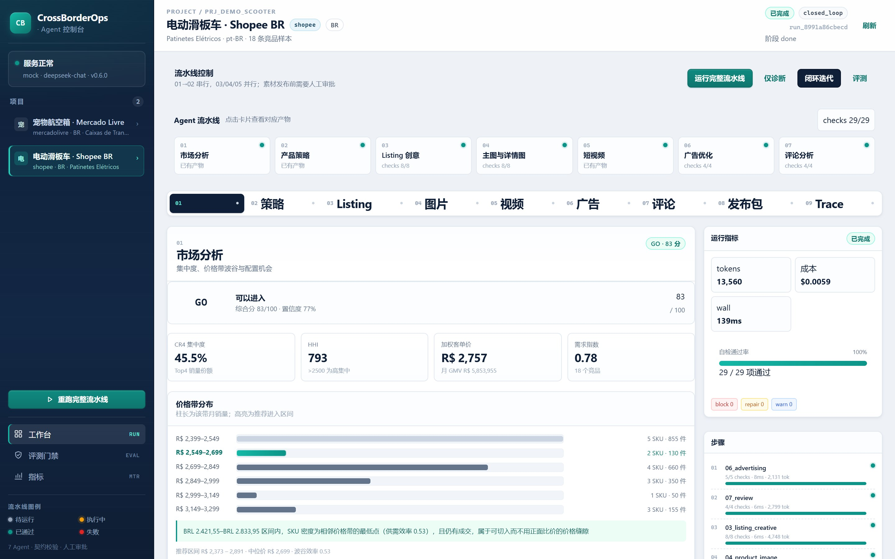
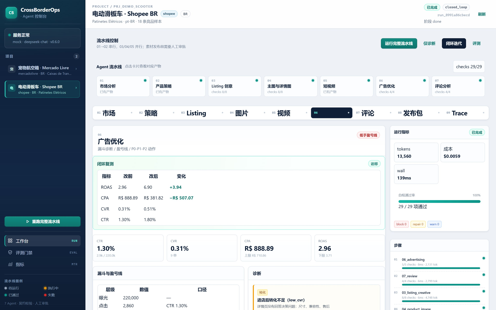
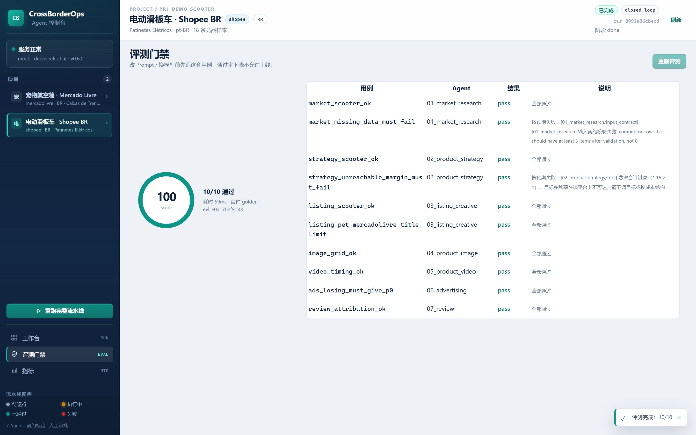

# CrossBorderOps · 跨境电商 AI 运营 Agent 平台

> 把跨境运营 SOP 里的经验，变成**可运行、可校验、可回流**的 7 个 AI Agent 工作流。
> 不是 Prompt 合集，是一套能跑起来、能被评测、能被替换模型、能被容器化部署的工程实现。

[](https://www.python.org/)
[](https://fastapi.tiangolo.com/)
[](https://docs.pydantic.dev/)
[](https://github.com/Zzhaocc/E-_commerce_Agent/actions/workflows/ci.yml)
[]()
[]()
[](LICENSE)

---

## 这是什么

参考项目 [AI-Cross-Border-Ecommerce-Agent-Toolkit](https://github.com/heqiangdiao-wq/AI-Cross-Border-Ecommerce-Agent-Toolkit)
把跨境运营 SOP 拆成了 7 个 Agent 的 **Prompt + 模板 + 案例**。

本项目做的是它的**工程化落地**：把那套方法论变成一个真正能跑的系统 ——

| 参考项目给了 | 本项目补齐了 |
|---|---|
| 7 个 Agent 的系统 Prompt | 带输入/输出契约的 Agent 运行时（JSON Schema 校验 + 失败重试） |
| "能算的别让模型猜" 的原则 | 13 个确定性工具（CR4/HHI/价格带波谷/净利率/字符校验/像素校验/时序校验） |
| 合规红线清单 | 可执行的三级护栏（repair / block / warn），命中即阻塞发布 |
| 闭环工作流的图 | 真正落地的回流：诊断 → 生成 FeedbackEvent → 素材 v2 → 用第二窗口数据复测 |
| 手工自检清单 | 66 个自动化测试 + 10 条 golden eval（含"必须失败"的负向用例） |

**一句话**：它回答的是"当一个 Agent 要上生产，除了 Prompt 还差什么"。

---

## 30 秒跑起来

不需要 API key。

### Docker（推荐）

```bash
git clone https://github.com/Zzhaocc/E-_commerce_Agent.git
cd E-_commerce_Agent
docker compose up -d --build
```

打开 <http://127.0.0.1:8000>。数据落在具名卷 `app-data`，`docker compose down` 不会丢。

### 本地

```bash
git clone https://github.com/Zzhaocc/E-_commerce_Agent.git
cd E-_commerce_Agent
pip install -r requirements.txt
python -m uvicorn app.main:app --port 8000
```

Windows 也可以直接双击 `start.bat`，或运行 `.\scripts\run.ps1 -Port 8000`。

### 不启服务也能验证

```bash
python scripts/demo.py      # 端到端跑完整链路，打印每一步的自检与成本
```

内置两个示例项目（Shopee 电动滑板车 / Mercado Livre 宠物航空箱），
点「运行完整流水线」即可看到 7 个 Agent 依次产出市场报告、定价方案、葡语 Listing、9 图规划、短视频脚本。

---

## 控制台



左侧选项目、顶部看运行状态、中间是 7 个 Agent 的流水线与产物、右侧是本次运行的成本与自检。
点任意 Agent 卡片可切到对应产物页；「闭环迭代」会跑完整条诊断→回流→v2→复测链路。

| 广告诊断（含复测） | 评测门禁 |
|---|---|
|  |  |

更多截图见 [`docs/screenshots/`](docs/screenshots/)：策略、Listing、9 图、视频、评论、Trace、发布包、平台指标。

---

## 它解决什么问题

跨境运营的难点不是"不知道要做什么"，而是**同样的 SOP，新人做出来下限很低**：

1. **数字靠感觉** —— 价格带、净利率、可承受 CPA，模型"估"出来的数字无法复核；
2. **格式不可控** —— 标题超字符、参数与实物不符、主图叠满文字，人工一条条盯；
3. **改完不知道有没有用** —— 一次性生成工具产出的素材，永远不会因为真实数据变准。

本项目的三个对应设计：

| 问题 | 设计 |
|---|---|
| 数字靠感觉 | **确定性优先**：先跑脚本算，Agent 只负责解读，`evidence` 里的数字禁止改写 |
| 格式不可控 | **双契约**：输入缺字段直接 422，输出多字段校验失败；再加事后护栏自动修复或阻塞 |
| 改完没用 | **闭环回流**：06/07 的诊断变成可追溯的 FeedbackEvent，驱动 03/04 出新版本，并用第二窗口数据复测 |

---

## 架构

```text
                    ┌──────────────────── 接入层 ────────────────────┐
                    │  REST /api  ·  Web 控制台  ·  Swagger /docs     │
                    │  中间件：CORS → X-Request-ID → 安全响应头       │
                    └───────────────────────┬──────────────────────┘
                                            │
        ┌───────────────────────────────────▼───────────────────────────────────┐
        │                         工作流引擎 RunEngine                           │
        │  状态机 queued→running→[awaiting_approval]→completed/failed          │
        │  五条路径：full_pipeline · creative_only · single · diagnose · loop  │
        │  断点字段 context / 步骤级 StepRun / 产物版本 Artifact.version        │
        └───────┬───────────────────────────────┬───────────────────────────────┘
                │                               │
     ┌──────────▼──────────┐         ┌──────────▼──────────┐
     │   Agent 运行时       │         │    确定性工具层      │
     │ 契约校验→证据→循环   │◄────────►│ 13 个纯函数工具      │
     │ →输出校验→护栏      │         │ Pydantic 参数校验    │
     └──────────┬──────────┘         └─────────────────────┘
                │
     ┌──────────▼──────────┐         ┌─────────────────────┐
     │   LLM Provider 层    │         │   可观测 / 评测      │
     │ mock / openai 兼容   │         │ TraceSpan · 结构化日志│
     └─────────────────────┘         │ 66 tests · golden   │
                                     └─────────────────────┘
```

分层、状态机、契约、护栏、闭环与取舍详见 [架构与设计决策](docs/ARCHITECTURE.md)。

### 一次 Agent 调用的完整轨迹

```text
输入契约校验 ── 缺字段 → 直接失败（不生成、不猜）
      │
      ▼
证据工具预计算 ── market_metrics → CR4/HHI/价格带（带 trace span）
      │
      ▼
LLM + function calling 循环 ── 上限 3 轮，防死循环烧钱
      │
      ▼
输出契约校验 ── 失败 → 带着错误信息自动重试 1 次
      │
      ▼
事后护栏 ── 标题超长→截断(repair)｜命中禁用词→阻塞发布(block)｜溯源性不足→告警(warn)
      │
      ▼
落库 ── StepRun + Artifact(version) + TraceSpan + 运行指标
```

---

## 7 个 Agent

| # | Agent | 职责 | 调用的确定性工具 | 产物 |
|---|---|---|---|---|
| 01 | 市场分析 | 能不能进、从哪个价格带进 | `market_metrics` `platform_rules` | 市场报告 |
| 02 | 产品策略 | 定位、唯一卖点、定价、SKU 四角色 | `unit_economics` `sku_ladder` | 策略书 |
| 03 | Listing 创意 | 关键词分层 → 葡语标题 → 五点 → 详情页 | `title_lint` `spec_consistency` | Listing 包 |
| 04 | 主图/详情图 | 9 图规划 + 出图 Prompt + 像素合规 | `check_main_image` | 图片包 |
| 05 | 短视频 | 钩子 → 分镜 → 口播 → 字幕时长校验 | `video_timing` | 视频包 |
| 06 | 广告优化 | 漏斗诊断 + 盈亏线 + P0/P1/P2 动作 | `ad_metrics` `budget_realloc` | 诊断计划 |
| 07 | 评论分析 | 八类归因 → 可修复率 → 页面修补 | `review_stats` `selling_point_rank` | 评论洞察 |

**闭环**（这是和"一次性生成工具"的分界线）：

```text
01 市场 ──► 02 策略 ──► 03 ∥ 04 ∥ 05 ──► 人工审批 ──► 发布包
                            ▲                              │
                            │                      06 广告诊断
                            │                      07 评论归因
                            └──── FeedbackEvent ◄──────────┘
                                  （P0/P1 分级、可追溯）
                                        │
                                  素材 v2 + 第二窗口复测
                                  ROAS 2.96 → 6.90 ✅
```

---

## 五个关键设计决策

### 1. 双契约，而不是"让模型尽量按格式输出"

```python
class MarketInput(InputModel):  # extra="allow"
    competitor_rows: list[CompetitorRow] = Field(min_length=3)  # 少于 3 条直接拒绝


class MarketOutput(StrictModel):  # extra="forbid"
    precheck: PrecheckOut  # verdict 只能是 GO/CAUTION/NO_GO
    confidence: float = Field(ge=0, le=1)
```

- 输入侧：缺字段 → `422`，**宁可失败，不许编造**；
- 输出侧：多一个字段就校验失败 → 自动带错误信息重试一次；
- 枚举/范围约束把"看起来对"的幻觉挡在落库之前。

### 2. 数字交给脚本，模型只做解读

`unit_economics` 的反解公式写在代码里，可以手算复现：

```text
net = P·(1 − commission − payment − ad_rate − coupon) − (cogs + freight)
盈亏价 P* = cost / (1 − rate_sum − coupon)
目标价 P  = cost / (1 − rate_sum − coupon − target_margin)
券余量    = 目标价下的净利（= 最多还能让多少钱）
```

价格带波谷也是可解释的：在 p25–p75 内找 **SKU 密度局部最低且仍有成交** 的带宽，
而不是"问模型哪个价位好"。

### 3. 护栏分三级，能修的不阻塞，该挡的必须挡

| 级别 | 例子 | 行为 |
|---|---|---|
| `repair` | 标题 128 字符 > 上限 120 | 按词边界截断，记录修复事件，落库为已通过 |
| `block` | 标题命中 `original` / `melhor do mundo` | `compliance.passed=false`，**禁止生成发布包** |
| `warn` | 参数溯源率 80%、视频字幕语速偏快 | 记录并放行，进入人工审批视野 |

关键点：护栏是**代码**，不是 Prompt 里的一句"请注意合规"。Prompt 会被模型忽略，代码不会。

### 4. 闭环是版本化的，不是覆盖

`Artifact` 带 `version` 与 `status`（draft / approved / superseded）。
闭环时旧的 Listing 变 `superseded`，新的 v2 记录 `applied_feedback`：
改了哪一条、来自哪个 Agent 的哪条证据，全部可回溯。

### 5. 可观测与评测是"能改"的前提

- 每次 LLM / 工具 / 护栏调用都落 `TraceSpan`，带 token、成本、延迟；
- 结构化日志（`text` / `json`）带 `request_id`，响应头 `X-Request-ID` 与日志可对齐；
- 运行级指标：步骤数、checks 通过率、护栏分布、wall time；
- golden eval 10 条，其中 2 条是**负向用例**：缺竞品数据、费率不可达时必须失败。
  改 Prompt / 换模型先跑评测，通过率掉了就不合并。

更多取舍与"为什么不用 LangGraph""怎么防死循环"等问题见 [设计问答](docs/DESIGN_FAQ.md)。

---

## 配置

全部通过环境变量注入，完整清单见 [`.env.example`](.env.example) 与 [运维手册](docs/OPERATIONS.md)。

| 变量 | 默认 | 说明 |
|---|---|---|
| `LLM_PROVIDER` | `mock` | `mock`（离线）/ `openai_compatible`（真实模型） |
| `LLM_BASE_URL` `LLM_MODEL` `LLM_API_KEY` | — | OpenAI 兼容网关接入参数 |
| `DATABASE_URL` | `sqlite:///./data/studio.db` | 换 PostgreSQL 只改这一行 |
| `HUMAN_APPROVAL` | `true` | 素材发布前是否必须人工审批 |
| `MAX_TOOL_STEPS` / `MAX_ATTEMPTS` | `4` / `2` | 工具轮次与输出重试上限 |
| `CORS_ORIGINS` | `*` | 生产填具体域名 |
| `LOG_LEVEL` / `LOG_FORMAT` | `INFO` / `text` | `json` 用于日志采集 |
| `DOCS_ENABLED` | `true` | 生产建议关闭 `/docs` |

---

## API 示例

完整接口见 [`docs/API.md`](docs/API.md)，`examples/` 下是可直接执行的 JSON / `.http`。

```bash
# 探针与能力目录
curl http://127.0.0.1:8000/api/health
curl http://127.0.0.1:8000/api/ready
curl http://127.0.0.1:8000/api/meta/catalog

# 跑完整流水线（异步，返回 run_id 轮询）
curl -X POST http://127.0.0.1:8000/api/projects/prj_demo_scooter/runs \
  -H "Content-Type: application/json" -d '{"mode":"full_pipeline"}'

# 查询运行 + trace + 回流事件
curl http://127.0.0.1:8000/api/runs/{run_id}
curl http://127.0.0.1:8000/api/runs/{run_id}/trace
curl http://127.0.0.1:8000/api/runs/{run_id}/feedback

# 人工审批后发布
curl -X POST http://127.0.0.1:8000/api/runs/{run_id}/approve

# 单 Agent 预览（带 checks / guardrails / trace）
curl -X POST http://127.0.0.1:8000/api/agents/03_listing_creative/preview \
  -H "Content-Type: application/json" -d @examples/listing_preview.json

# 直接调确定性工具（口径可复算）
curl -X POST http://127.0.0.1:8000/api/tools/unit_economics/invoke \
  -H "Content-Type: application/json" -d @examples/tool_unit_economics.json
```

所有错误响应统一为 `{"detail": ..., "request_id": ...}`，排查时按 `request_id` 检索日志。

---

## 接入真实模型

默认 `mock` provider 是**规则型 Agent**：数值来自真实工具、文案来自商品知识库，
用于无 key 运行与回归基线。接真实模型只改环境变量：

```bash
LLM_PROVIDER=openai_compatible
LLM_BASE_URL=https://api.deepseek.com/v1
LLM_API_KEY=sk-xxx
LLM_MODEL=deepseek-chat
```

`app/llm/openai_compat.py` 是标准的 `/chat/completions` 实现，DeepSeek / Qwen / vLLM /
Ollama / 任何中转网关都能接。**换模型不动业务代码**，因为所有 Agent 只依赖 `chat()` 一个方法。

配置写错时不会静默降级：`/api/health` 会返回 `provider_error` 说明原因。

---

## 目录结构

```text
E-_commerce_Agent/
├── app/
│   ├── main.py                  # 应用装配、中间件、启动自检、崩溃恢复
│   ├── config.py                # 环境变量配置
│   ├── logging.py               # 结构化日志 + request_id 注入
│   ├── middleware.py            # 请求关联 ID、访问日志、安全响应头
│   ├── errors.py                # 统一错误响应
│   ├── db.py / models.py        # SQLAlchemy 模型（Run/StepRun/Artifact/TraceSpan/FeedbackEvent）
│   ├── api/                     # REST 路由 + 请求模型
│   ├── agents/
│   │   ├── contracts.py         # 7 个 Agent 的输入/输出契约
│   │   ├── prompts.py           # 系统 Prompt（五段式）
│   │   ├── registry.py          # 输入适配 + 证据工具 + 工具白名单
│   │   ├── runtime.py           # 契约→证据→工具循环→校验→护栏
│   │   └── gates.py             # 三级护栏
│   ├── tools/                   # 13 个确定性工具
│   ├── llm/                     # Provider 抽象、mock、OpenAI 兼容、商品知识库
│   ├── workflow/engine.py       # 状态机、并行创意簇、审批、闭环、版本化
│   ├── eval/runner.py           # golden 评测（含负向用例）
│   └── seed.py                  # 两个示例项目（含广告/评论/复测数据）
├── web/                         # 零依赖单页控制台
├── tests/                       # 66 个测试
├── examples/                    # 可直接执行的请求示例
├── scripts/                     # demo.py / smoke_http.py / run.ps1
├── docs/                        # 架构、API、设计问答、运维手册
├── Dockerfile                   # 多阶段构建，非 root 运行
├── docker-compose.yml
└── Makefile                     # install / run / test / lint / demo / docker-*
```

---

## 部署与运维

```bash
make install-dev     # 安装开发依赖
make test            # 测试 + 覆盖率
make lint            # ruff 静态检查
make eval            # golden 评测
make smoke           # 对已启动的服务做端到端冒烟
make docker-build    # 构建镜像
```

- **探针**：`/api/health`（存活，不查库）、`/api/ready`（就绪，查库与注册表）；
- **日志**：`LOG_FORMAT=json` 接采集平台，按 `request_id` 关联一次请求；
- **备份**：`sqlite3 data/studio.db ".backup ..."`，恢复步骤见运维手册；
- **扩容**：单机走线程池，多机需要换 PostgreSQL + 任务队列；内置接口不带鉴权，对外必须置于网关之后。

完整部署形态、故障排查表与上线检查清单见 [运维手册](docs/OPERATIONS.md)，
安全边界与漏洞报告流程见 [SECURITY.md](SECURITY.md)。

---

## 测试与评测

```bash
# 1) 全量测试
python -m pytest -q
# 66 passed

# 2) 回归评测（含负向用例）
python -m app.eval.runner
# 10/10，score 1.0

# 3) 端到端演示（创建 → 跑流水线 → 审批 → 闭环 → 复测）
python scripts/demo.py
```

本机实测（mock provider）：全链路约 0.1–0.2 s、31 项自检全过、单次约 14.6k token / $0.0066。
数字随机器与依赖版本波动，可直接用 `python scripts/demo.py` 复现。

CI 在 push / PR 时跑 ruff + pytest（3.11 / 3.13）+ golden 评测 + HTTP 冒烟，见 [`.github/workflows/ci.yml`](.github/workflows/ci.yml)。

---

## 已知边界

- `mock` provider 的文案来自知识库模板，用于保证离线可复现；真实模型下文案质量取决于模型，
  但契约、护栏、评测、闭环链路完全一致；
- 不做真实平台 API 对接、真实出图/出视频 —— 只留适配位（见 Roadmap）；
- 内置接口不带鉴权，多租户与权限仍在 Roadmap；
- SQLite 为单写者，高并发写入需换 PostgreSQL。

---

## Roadmap

| 版本 | 内容 |
|---|---|
| v0.7（当前） | 生产化加固：结构化日志与 request_id、统一错误契约、就绪探针、容器化、安全与运维文档 |
| v0.8 | 平台 API 适配器（Shopee / Mercado Livre 拉数与回写） |
| v0.9 | 向量记忆：跨项目复用"某个类目的历史诊断" |
| v1.0 | 批量任务与定时调度（每日自动诊断 → 只把 P0 推到人） |
| v1.1 | 多租户 + 权限 + PostgreSQL + 对象存储 |

变更记录见 [CHANGELOG.md](CHANGELOG.md)。

---

## 文档

- [架构与设计决策](docs/ARCHITECTURE.md) —— 分层、状态机、契约、护栏、闭环、可观测、安全边界
- [设计问答](docs/DESIGN_FAQ.md) —— 为什么这么设计、每个取舍的代价
- [API 参考](docs/API.md) —— 全部端点、错误契约与示例
- [运维手册](docs/OPERATIONS.md) —— 部署形态、探针、日志排障、备份、扩容、上线清单
- [安全策略](SECURITY.md) —— 安全边界与漏洞报告流程
- [贡献指南](CONTRIBUTING.md) —— 本地开发、PR 前必过的检查、如何新增 Agent

---

## 致谢与许可

- 方法论与业务口径参考 [AI-Cross-Border-Ecommerce-Agent-Toolkit](https://github.com/heqiangdiao-wq/AI-Cross-Border-Ecommerce-Agent-Toolkit)；
- 示例数据为脱敏样本，不含真实店铺、账号与买家信息；
- MIT License，见 [LICENSE](LICENSE)。
