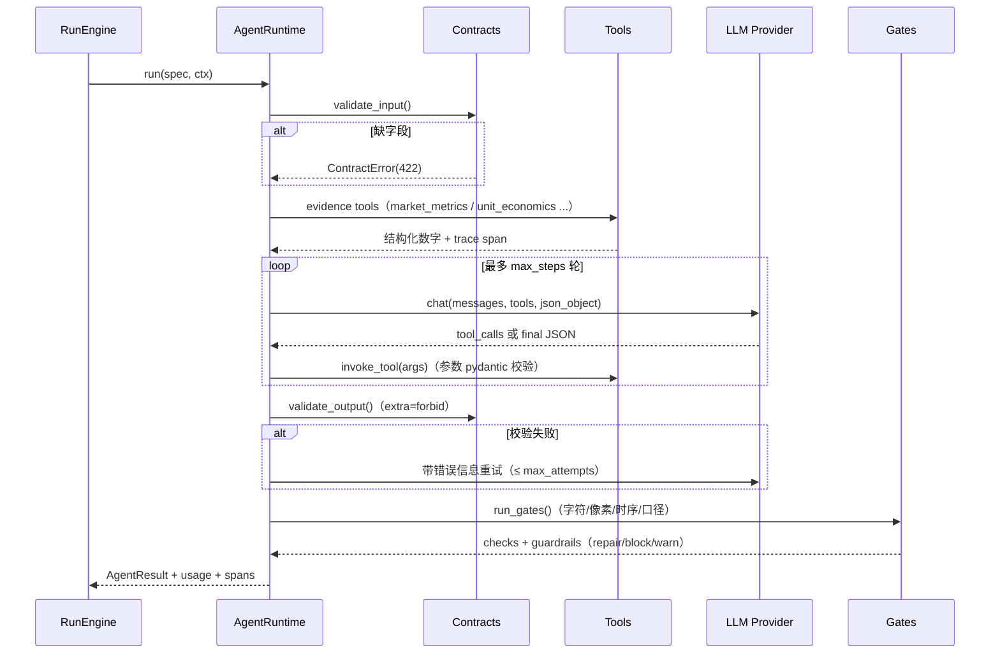

# 架构与设计决策

> 本文记录分层、运行时、契约、护栏、闭环、可观测与运维边界等设计决策。

## 1. 目标与非目标

**目标**

1. 把 7 个 SOP Agent 串成一条可运行、可中断、可回流的流水线；
2. 让"数字"可复核、"格式"可强制、"合规"可执行，而不是靠模型自觉；
3. 让系统可替换模型、可观测成本、可回归评测、可容器化部署。

**非目标（明确不做）**

- 真实平台 API 拉数与回写（只留适配位，见 Roadmap）；
- 真实出图 / 出视频（只产出结构化 Prompt 包）；
- 多租户、计费与前端工程化（当前是单租户部署形态）。

---

## 2. 分层

```text
┌──────────────────────────────────────────────────────────────────┐
│ 接入层   FastAPI 路由 / Web 控制台 / Swagger                     │
│          中间件：CORS → 请求关联 ID → 安全响应头                 │
├──────────────────────────────────────────────────────────────────┤
│ 编排层   RunEngine：状态机、并行创意簇、审批、闭环、版本化       │
├──────────────────────────────────────────────────────────────────┤
│ 执行层   AgentRuntime：契约 → 证据 → 工具循环 → 校验 → 护栏      │
├──────────────────────────────────────────────────────────────────┤
│ 能力层   13 个确定性工具 + Prompt + Provider 抽象                │
├──────────────────────────────────────────────────────────────────┤
│ 支撑层   SQLAlchemy 模型 / TraceSpan / 结构化日志 / 评测 / 配置  │
└──────────────────────────────────────────────────────────────────┘
```

依赖方向自上而下，**执行层不依赖 FastAPI**，所以 `scripts/demo.py` 可以在没有 HTTP 的情况下跑完整条链路——
这也是测试能直接调引擎、CI 能在无服务器的情况下验证业务逻辑的原因。

---

## 3. 数据模型

| 表 | 作用 | 关键字段 |
|---|---|---|
| `projects` | 商品事实与目标平台 | `brief`（成本、竞品、广告、评论）、`platform`、`language` |
| `runs` | 一次运行 | `mode`、`status`、`stage`、`metrics`、`context`（断点） |
| `step_runs` | 单个 Agent 执行 | `output`、`checks`、`guardrails`、`tokens_*`、`cost_usd`、`attempts` |
| `artifacts` | 可交付产物 | `kind`、`version`、`status`（draft/approved/superseded）、`content` |
| `trace_spans` | 统一 trace | `kind`（llm/tool/guardrail）、`latency_ms`、`tokens`、`attrs` |
| `feedback_events` | 回流 | `source_agent`、`target_agent`、`severity`、`issue`、`action` |
| `eval_runs` | 评测 | `suite`、`score`、`results` |

为什么 `Run` 与 `StepRun` 分开：只有步骤级记录才能做 trace、成本归因、断点续跑。
为什么 `Artifact` 带版本：闭环不是覆盖，而是"新版本 + 旧版本 superseded"，任何一次投放都可回溯。

---

## 4. Agent 运行时



三个关键取舍：

1. **证据先算**：模型拿到的是已经算好的 `evidence`，Prompt 明确"这些数字必须原样使用"。
2. **能重试的错误分两类**：格式错误（JSON / Schema）自动重试；数据缺失不重试，直接失败。
3. **工具调用有上限**：`max_steps=2~3`，超过直接抛错，避免模型死循环烧钱。

---

## 5. 双契约

```python
class MarketInput(InputModel):  # extra="allow"
    competitor_rows: list[CompetitorRow] = Field(min_length=3)


class MarketOutput(StrictModel):  # extra="forbid"
    precheck: PrecheckOut  # verdict ∈ {GO, CAUTION, NO_GO}
    confidence: float = Field(ge=0, le=1)
```

| 方向 | 策略 | 目的 |
|---|---|---|
| 输入 | 必填 + 范围 + 最少样本 | 数据不够就不许开工，杜绝"编一份市场报告" |
| 输出 | 禁多字段 + 枚举 + 范围 | 挡住"看起来对"的幻觉字段与越界值 |

输出校验失败时，运行时把 Pydantic 的错误原文回灌给模型重试一次。
`tests/test_agents.py::test_output_contract_failure_triggers_repair_retry` 验证了这条路径。

---

## 6. 工具层

13 个纯函数，全部 `extra="forbid"` 参数校验、无副作用、可单测：

| 分类 | 工具 | 关键口径 |
|---|---|---|
| 市场 | `market_metrics` | CR4=销量份额 Top4；HHI=Σ份额²×10000；加权分位；波谷=SKU 密度局部最低且销量占比≥2% |
| 定价 | `unit_economics` `sku_ladder` | `net = P(1−费率−coupon) − 成本`；反解盈亏价 / 目标价 / 券余量 |
| Listing | `title_lint` `spec_consistency` `keyword_classify` | 字符 / 前 30 权重 / 堆砌 / 禁用词 / 参数溯源 |
| 图片 | `check_main_image` | 用标准库解析 PNG / JPEG 头，尺寸 / 比例 / 白底 / 文字占比 |
| 视频 | `video_timing` | 时间轴连续性、总时长偏差、字幕语速 |
| 广告 | `ad_metrics` `budget_realloc` | 漏斗、可承受 CPA / CPC、ROAS 下限、P0/P1/P2 信号 |
| 评论 | `review_stats` `selling_point_rank` | 八类归因、可修复率、误解率、卖点口碑排序 |

测试里约一半是工具口径测试，改公式会立刻红。

---

## 7. 三级护栏

| 级别 | 触发例子 | 行为 | 是否阻塞发布 |
|---|---|---|---|
| `repair` | 标题超长、图片文案超 16 字、主图有文字 | 自动修复并记录 | 否 |
| `block` | 命中禁用词、参数与事实冲突、亏损但无 P0 动作 | `compliance.passed=false` | **是** |
| `warn` | 参数溯源率低、字幕语速快、样本量小 | 记录，进入人工审批视野 | 否 |

设计原则：**能自动修的不打扰人，该人判断的必须拦下来**。
`engine.publish()` 在生成发布包前再次检查 `compliance.passed`，护栏不通过直接拒绝发布。

---

## 8. 工作流引擎

```text
                 ┌──────────┐
   create_run ──►│  queued  │
                 └────┬─────┘
                      ▼
                 ┌──────────┐   异常
                 │ running  │──────────► failed
                 └────┬─────┘
        ┌─────────────┼──────────────┐
        ▼             ▼              ▼
   full_pipeline  diagnose      closed_loop
   01→02→03∥04∥05  06→07        06→07→回流→03/04→复测
        │
        ▼
  awaiting_approval ──approve──► completed
        │
        └──reject──► cancelled
```

- **并行**：03/04/05 只依赖 02，用 `ThreadPoolExecutor(3)` 并行；持久化用全局写锁串行化（SQLite 单写者）。
- **断点**：`runs.context.completed_steps` 记录已完成步骤；进程重启时把 `running` 标为 `failed` 并给出可重试提示。
- **审批**：默认开启（`HUMAN_APPROVAL=true`）。素材发布前必须有人点通过——这是合规责任边界，不是技术选择。
- **隔离**：每次运行在独立线程里执行，异常统一收敛为 `failed` + 错误信息，不影响进程内其它请求。

---

## 9. 闭环与版本化

回流规则是**代码**，不是 Prompt：

```python
# 只有"改素材"类 P0 动作才回流给创意 Agent；调价/预算类留在广告计划里
if any(k in action for k in ("主图", "图片", "详情页", "标题", "视频")):
    target = "04_product_image" if "主图" in action else "03_listing_creative"
```

评论侧：每条 `listing_patch` / `image_patch` 生成一条 `P1` 回流，带 `evidence_count`。

版本化：新产物 `version = max(version)+1`，旧版本置 `superseded`；
v2 的 `content.applied_feedback` 记录"改了哪条、来自哪条证据"。

复测：如果传入 `ad_rows_after`，再跑一次 06，对比 ROAS / CPA / CVR / CTR，给出 `verdict`。
示例数据：ROAS 2.96 → 6.90，CPA 889 → 382。

> 说明：示例里的"第二窗口数据"是预置的，模拟真实投放回传；
> 生产环境应由平台 API 按日回填，引擎的对比逻辑不变。

---

## 10. Provider 抽象与离线实现

```python
class LLMProvider(Protocol):
    def chat(messages, tools, response_format, meta) -> ChatResult: ...
```

- `openai_compat.py`：标准 `/chat/completions`，支持 function calling 与 JSON 输出；
- `mock.py`：规则型实现，数值来自真实工具、文案来自商品知识库。

离线实现解决三个工程问题：

1. CI 与本地开发环境没有 API key，链路也必须能跑通；
2. 回归评测需要**确定性基线**，否则每次跑分都在抖；
3. 把"模型能力"和"工程质量"解耦——护栏、闭环、版本化不依赖模型好坏。

接真实模型只改环境变量，业务代码零改动。

---

## 11. 可观测、成本与日志

**Trace**（落库，可按 run 查询）

- 每个 LLM 调用一个 span（tokens、成本、延迟、轮次）；
- 每个工具调用一个 span（参数键、耗时、失败原因）；
- 每个护栏一个 span（通过数、失败数、block / repair / warn）；
- 运行级聚合：steps、tokens、cost、checks 通过率、wall time；
- 平台级：成功率、按 Agent 的成本 / 延迟 / 通过率（`/api/metrics/overview`）。

**日志**（`app/logging.py`）

- 两种格式：`text`（本地阅读）/ `json`（Loki / ELK / CloudWatch 采集）；
- 每条日志自动带 `request_id`，与响应头 `X-Request-ID` 一致，报错可直接定位；
- 关键事件：`startup` / `run_created` / `run_started` / `step_succeeded` / `run_finished` / `run_failed`；
- 访问日志由中间件统一输出（`method`、`path`、`status`、`duration_ms`），避免 uvicorn 与业务日志重复。

**成本口径**：`cost = tokens_in/1000 × 单价_in + tokens_out/1000 × 单价_out`，单价由 `COST_PER_1K_IN` / `COST_PER_1K_OUT` 配置。

---

## 12. 评测

10 条 golden case，2 条是**负向**的：

| 用例 | 断言 |
|---|---|
| `market_scooter_ok` | CR4/HHI 范围、价格带次序、机会点 ≥3 |
| `market_missing_data_must_fail` | 竞品 <3 条 → 必须失败 |
| `strategy_scooter_ok` | 四角色齐全、目标价≥盈亏价、净利率 15% |
| `strategy_unreachable_margin_must_fail` | 费率+目标净利率 >100% → 必须失败 |
| `listing_scooter_ok` | 标题 40–120、五点、无禁用词、参数可溯源 |
| `listing_pet_mercadolivre_title_limit` | ML 60 字符上限 + 截断后不是残词 |
| `image_grid_ok` | 9 图、slot 连续、主图无字、Prompt 完整 |
| `video_timing_ok` | 时长±15%、钩子、字幕 ≤28 字 |
| `ads_losing_must_give_p0` | 亏损必须给 P0 且 SLA ≤24h |
| `review_attribution_ok` | 样本数一致、八类归因、有修补建议 |

为什么要有负向用例：**Agent 最危险的失败不是"答得不好"，而是"数据不够时编一个答案"**。

---

## 13. 安全与部署边界

| 关注点 | 设计 |
|---|---|
| 身份认证 | 内置接口不带鉴权，默认监听 `127.0.0.1`；对外部署须置于网关 / Ingress 后并接入 OIDC 或 API Key |
| 密钥 | 只从环境变量读取，不落库、不进日志；`.env` 已在 `.gitignore` |
| 请求追踪 | 支持透传上游 `X-Request-ID`，缺失时生成，回写响应头并注入所有日志 |
| 错误回显 | 未预期异常只返回 `request_id`，不回显堆栈与内部路径 |
| 响应头 | `nosniff` / `SAMEORIGIN` / `no-referrer` / 最小化 `Permissions-Policy` |
| 输入校验 | 双契约 + 工具参数 `extra="forbid"`，非法输入在进入模型前就被拒绝 |
| 发布闸门 | `HUMAN_APPROVAL=true` 时素材必须人工通过，护栏 `block` 时禁止生成发布包 |
| 数据 | 示例数据已脱敏，不含真实店铺、账号与买家信息 |

部署形态与运维细节见 [运维手册](OPERATIONS.md)，安全报告流程见 [SECURITY.md](../SECURITY.md)。

---

## 14. 新增一个 Agent（4 步）

1. `contracts.py` 加输入 / 输出模型，注册进 `CONTRACTS`；
2. `prompts.py` 加五段式系统 Prompt；
3. `registry.py` 加 `build_input` + `evidence` + 工具白名单（+ 可选 `gates`）；
4. 需要新算法时在 `tools/` 加一个 `@tool` 纯函数 + 单测。

引擎、API、控制台、评测不需要改——它们都按注册表驱动。

---

## 15. 关键取舍

| 决策 | 选择 | 理由 | 代价 |
|---|---|---|---|
| 编排框架 | 自研轻量状态机 | 7 个固定步骤 + 一条回流边，图编排能力用不上；自研可读、可测、依赖少 | 复杂动态图需要自己扩展 |
| 数字来源 | 确定性工具优先 | 可复核、可单测、公式可手算复现 | 需要维护工具与口径 |
| 结构化输出 | JSON Schema + 严格校验 | 挡住幻觉字段；失败可修复 | 严格模式可能误杀合法输出，输入侧用 `extra=allow` 平衡 |
| 存储 | SQLite + SQLAlchemy | 单机零依赖；换 PG 只改 `DATABASE_URL` | 并发写入需串行化 |
| 并行 | 线程池 | Agent 执行是 IO 等待（HTTP），GIL 影响小 | 不是分布式；多机需要队列 |
| 前端 | 零依赖原生 JS | 离线可用、无构建链 | 组件化程度低 |
| 模型 | mock + 真实双实现 | CI 与本地确定性，生产可替换 | mock 文案受知识库限制 |

---

## 16. 失败模式与对策

| 失败模式 | 现状对策 |
|---|---|
| 模型输出不是 JSON | 提取 `{...}` + 重试一次，仍失败则运行失败并记录原文 |
| 输出多字段 / 少字段 | Pydantic `extra=forbid` + 错误回灌重试 |
| 数据缺失 | 输入契约直接拒绝，不进入 LLM |
| 工具参数非法 | 工具层 `extra="forbid"` 校验，拒绝执行并记录 span |
| 标题超长 | 护栏按词边界截断（repair），不阻塞 |
| 命中禁用词 | 护栏 block，禁止生成发布包 |
| 工具死循环 | `max_steps` 上限 |
| 进程崩溃 | 启动时把 stale `running` 标为 failed，可重试 |
| 成本失控 | 每次调用计费 + 平台成本看板 + 轮次上限 |
| 改了 Prompt 变差 | golden eval 门禁（score < 0.9 视为回归） |
| 配置写错（如缺 API Key） | `/api/health` 返回 `provider_error`，启动日志打印配置摘要，不静默降级 |

---

## 17. 实测数据（本机，mock provider）

| 指标 | 数值 |
|---|---|
| 全量流水线耗时 | ~0.1–0.2 s（5 个 Agent，含 3 路并行） |
| 单次流水线 token | ~14.6k |
| 单次流水线成本 | ~$0.0066（按配置单价） |
| checks | 31 项，31 通过 |
| 测试 | 66 passed（~4 s） |
| 评测 | 10/10，score 1.0 |
| 闭环复测 | ROAS 2.96 → 6.90，CPA 889 → 382 |

> 上述数字随机器与依赖版本波动，可用 `python scripts/demo.py` 在本机复现。
